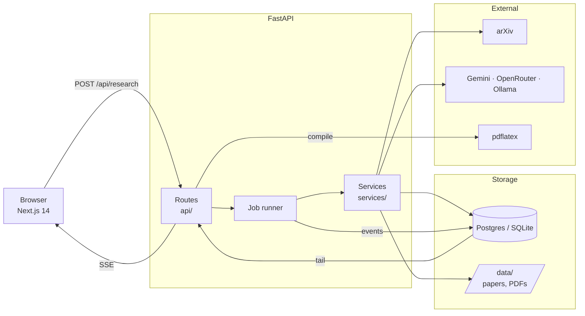
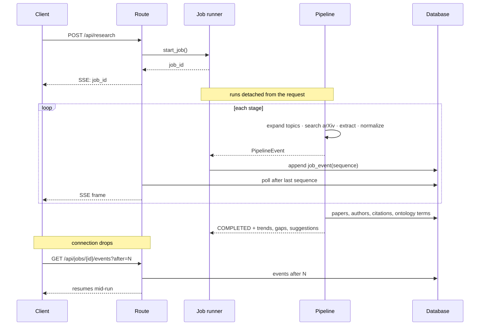

# Architecture

What the system does, how it is put together, and which trade-offs were
deliberate.

## Shape



Two projects, deployed separately because their runtime needs differ: the API
is a long-lived streaming service holding disk state, the web client is
static-ish and wants a CDN.

## A research run



## Decisions

### The pipeline is not the response

A run takes minutes — dozens of PDF downloads and a long chain of LLM calls.
Originally it executed inside the SSE generator, so the work *was* the HTTP
response: navigating away killed it, and everything already processed was
discarded with no record it had happened.

Now the pipeline emits `PipelineEvent`s, a runner persists them, and clients
tail the table. Disconnecting stops the reading, not the work.

The runner is in-process, so jobs die with the container and do not spread
across workers. That is the honest limit. The seam sits in the right place —
`services/jobs.py` is the only module that would change for Celery or ARQ.

### Postgres in production, SQLite by default

`DATABASE_URL` defaults to a local SQLite file, so `git clone && make dev`
works with nothing installed. Compose and production point it at Postgres. One
set of models, one set of migrations; CI applies them against both, because
SQLite is forgiving in ways Postgres is not.

### The graph is relational, the papers dump is not

`projects`, `papers`, `authors`, `citations` and `ontology_terms` are tables
because they are queried — by project, by processed state, by term. The raw
per-run extraction output stays a JSON file: it is read back whole by the
review pipeline and never queried field-by-field.

Both used to be files. The ontology in particular was a single global
`ontology.json` that every run rewrote in place, so concurrent runs clobbered
each other's terms and every run saw every other run's vocabulary.

### Extraction payloads stay JSON columns

`papers.extraction` and `papers.normalized` are JSON, not columns. Their shape
is set by the extraction prompt and changes whenever that prompt does; columns
would mean a migration per prompt edit.

### The LLM verbalizes, it does not decide

[`gap_finder.py`](be-main/gap_finder.py) finds gaps symbolically — method
transfer, dataset transfer, limitation pressure, unmet future work — from
coverage indices over the corpus. The LLM only phrases them as paper titles.

This is what makes [`evals/`](be-main/evals/README.md) possible. Detection is
inspectable and measurable; a prompt that "finds gaps" would be neither.

### Authors are scoped per project

Author names in bibliographies are not reliable identity. A global author table
would silently merge distinct people who share a name, and the slug only has to
be stable within one run.

### References deduplicate by title

Two papers citing the same work produce one node with two incoming edges.
The file-based version minted a fresh uuid per reference, so shared citations —
the signal a citation graph exists to show — appeared as disconnected nodes.

## Layout

```
be-main/
├── main.py            App wiring: CORS, rate limits, lifespan, migrations
├── api/               Routes. Validate, delegate, shape the response.
├── services/          Pipeline logic, transport-agnostic
│   ├── events.py          Progress events
│   ├── research_pipeline.py   Stage orchestration
│   ├── jobs.py            Background execution and event tailing
│   ├── gaps.py            Gap analysis → suggested papers
│   └── artifacts.py       On-disk run output
├── db/                Models, repositories, session, bootstrap
├── utils/             LaTeX, embeddings, charts, path containment
├── evals/             Gap detection benchmark
└── alembic/           Migrations

fe-main/
├── app/               App Router pages and feature components
├── lib/               API client, SSE handling, local stores
└── components/ui/     shadcn primitives
```

Routes are thin on purpose. `api/api.py` was 1085 lines with a single 440-line
function that expanded topics, searched arXiv, extracted papers, built the
graph, computed trends, ran gap analysis, *and* formatted SSE frames. Splitting
transport from logic is what made the job runner a contained change.

## Known limits

Stated plainly, because a reviewer will find them anyway:

- **No authentication.** Every run is anonymous, and anyone with a
  `project_id` can read that graph. Rate limiting is the only abuse control.
- **In-process jobs.** They do not survive a restart or spread across workers.
- **`utils/graph.py` is still 1268 lines.** `TrendsCreator` needs its
  per-analysis methods turned into standalone builders; that is a real
  refactor, not a file move.
- **Rate limit counters are per-process.** With N workers the effective limit
  is N×, until `RATE_LIMIT_STORAGE_URI` points at Redis.
- **Gap detection recall is 0.188** at the shipped output cap. Measured, with
  the trade-off curve in [`evals/README.md`](be-main/evals/README.md).
- **mypy runs against a subset.** Pre-refactor modules are silenced by name in
  `pyproject.toml`; the list is meant to shrink.

## Related documents

- [SECURITY.md](SECURITY.md) — untrusted input surfaces and what constrains them
- [DEPLOYMENT.md](DEPLOYMENT.md) — compose, native, and hosted setups
- [be-main/evals/README.md](be-main/evals/README.md) — gap detection benchmark
