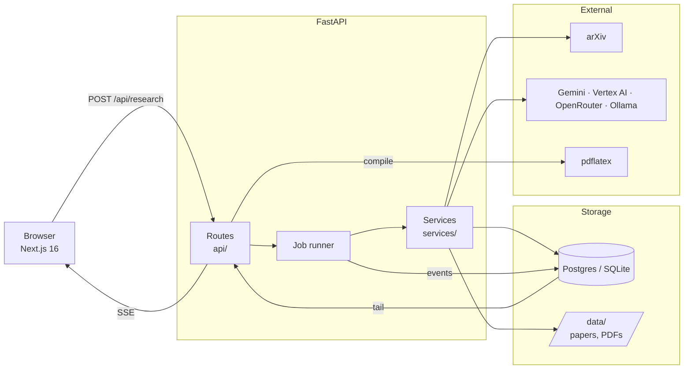
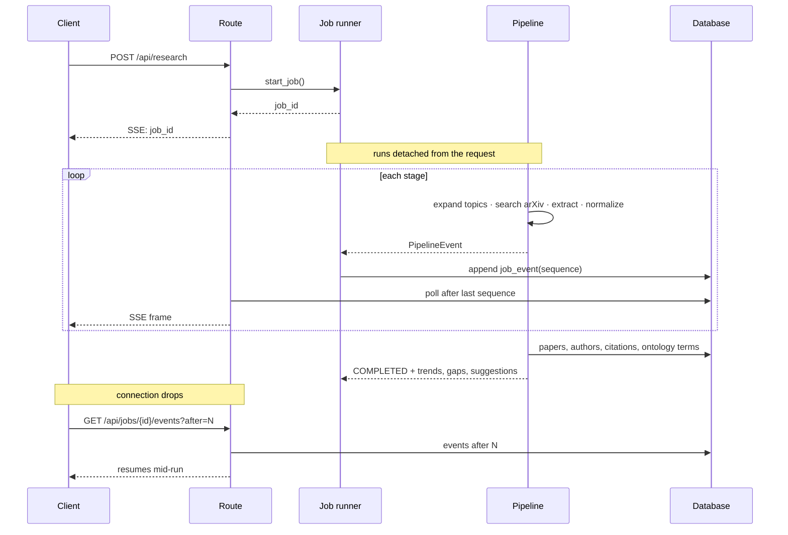

# Architecture

What the system does, how it is put together, and which trade-offs were
deliberate.

## Shape



Two projects, deployed separately because their runtime needs differ: the API
is a long-lived streaming service holding disk state, the web client is
static-ish and wants a CDN.

## A research run



## Decisions

### The pipeline is not the response

A run takes minutes — dozens of PDF downloads and a long chain of LLM calls.
Originally it executed inside the SSE generator, so the work *was* the HTTP
response: navigating away killed it, and everything already processed was
discarded with no record it had happened.

Now the pipeline emits `PipelineEvent`s, a runner persists them, and clients
tail the table. Disconnecting stops the reading, not the work.

The runner is in-process, so jobs die with the container and do not spread
across workers. That is the honest limit. The seam sits in the right place —
`services/jobs.py` is the only module that would change for Celery or ARQ.

### Postgres in production, SQLite by default

`DATABASE_URL` defaults to a local SQLite file, so `git clone && make dev`
works with nothing installed. Compose and production point it at Postgres. One
set of models, one set of migrations; CI applies them against both, because
SQLite is forgiving in ways Postgres is not.

### The graph is relational, the papers dump is not

`projects`, `papers`, `authors`, `citations` and `ontology_terms` are tables
because they are queried — by project, by processed state, by term. The raw
per-run extraction output stays a JSON file: it is read back whole by the
review pipeline and never queried field-by-field.

Both used to be files. The ontology in particular was a single global
`ontology.json` that every run rewrote in place, so concurrent runs clobbered
each other's terms and every run saw every other run's vocabulary.

### Extraction payloads stay JSON columns

`papers.extraction` and `papers.normalized` are JSON, not columns. Their shape
is set by the extraction prompt and changes whenever that prompt does; columns
would mean a migration per prompt edit.

### The LLM verbalizes, it does not decide

[`gap_finder.py`](be-main/gap_finder.py) finds gaps symbolically — method
transfer, dataset transfer, limitation pressure, unmet future work — from
coverage indices over the corpus. The LLM only phrases them as paper titles.

This is what makes [`evals/`](be-main/evals/README.md) possible. Detection is
inspectable and measurable; a prompt that "finds gaps" would be neither.

### Generated LaTeX is repaired, not trusted

The review prompt specifies a self-contained document: BibTeX entries in a
`filecontents` block before `\documentclass`, `natbib`, and `plainnat`. A local
qwen2.5:7b run ignored all three at once — `biblatex` instead of `natbib`, the
`plain` style, and the entries dumped after `\end{document}` behind a
`% references.bib` comment.

Each is independently fatal. `biblatex.sty` is absent from a minimal TeX
install, and nothing after `\end{document}` is ever read, so `references.bib`
was never written and every `\cite` resolved to nothing even where the package
did exist. The review endpoint produced documents its own compile endpoint
rejected.

[`utils/latex_review.py`](be-main/utils/latex_review.py) normalizes the output
into the documented shape before it is stored. Prompt compliance is a quality
signal; it is not something the compile step can depend on.

### Every LLM call is metered where it is made

Tokens, latency, throughput and estimated cost are recorded inside the three
provider clients ([`telemetry/llm.py`](be-main/telemetry/llm.py)), not at the
call sites. Nine call sites span extraction, references, topics, reranking,
datasets and reviews; instrumenting each would give every new one a chance to
be missed. In the client, nothing can bypass it.

Usage is what the provider reported — Gemini `usageMetadata` (thinking tokens
billed as output), Ollama's eval counters, OpenRouter's `usage` — and an
estimate only where nothing was reported, flagged so it cannot pass for a
measurement. Ollama also reports its own decode time, so throughput comes in
two kinds: decode tokens/sec (the model's speed) and end-to-end tokens/sec
(what a caller waits through). On the development machine those differ by
almost 3×, because a cold qwen2.5:7b spends most of a short call loading.

Calls are attributed to a job and a stage through context variables, which
reach worker threads only when the context is copied. The pipeline used
`run_in_executor`, which does not copy it; under it every call ran
unattributed. It now uses `asyncio.to_thread`, which does, and a test pins the
difference.

Each job is its own OpenTelemetry trace — job → paper → stage → LLM call, with
`gen_ai.*` attributes — rather than a child of the request that started it,
since the run outlives that request by minutes.

### Embeddings live beside the papers they describe

Retrieval passages and their vectors are rows in the same database as the
papers — pgvector's `vector` on Postgres, packed float32 on SQLite — not a
separate vector service. Deleting a project cascades to its passages, there is
one datastore to back up and secure, and Cloud SQL ships the extension.

Search is exact, on both databases. Every query is scoped to one project and
one embedding model: tens of papers, a few thousand passages. Scanning that
takes milliseconds — 2 to 21 ms over a real 644-passage corpus on SQLite — and
an approximate index (HNSW) would be built across every project and then
filtered to one, which is where approximate indexes lose recall.

Each paper yields two kinds of passage
([`retrieval/chunking.py`](be-main/retrieval/chunking.py)). *Text* passages
are its full text, split per section on sentence boundaries, with the
bibliography removed: a run of names and venues resembles every query about a
field and answers none. One *profile* passage renders the structured
extraction as prose, keeping each normalized term beside the paper's own
wording, so "human36m" finds "Human3.6M".

Two details carry most of the retrieval quality, and both are cheap. Passages
are embedded with their paper title and section in front of them — "our method
outperforms the baseline" means nothing on its own — while the stored text
stays as written. And documents and queries go to the embedding model with a
task hint (Gemini's `taskType`, nomic's `search_document:` / `search_query:`),
which is how asymmetric retrieval models are trained to be used.

Vectors from two models are not comparable, so rows are keyed by model, and
retrieval embeddings never take the reranking path's OpenRouter fallback:
switching providers mid-corpus would mix vector spaces silently. Switching on
purpose means re-indexing (`scripts/index_project.py`).

Section detection is heuristic, and the first real corpus broke it: PyMuPDF
prints LREC's "5.2.1." on one line and "Hardware and Sensor Setup" on the
next, and titles that bibliography "Bibliographical References". Every
passage in that paper was labelled with the wrong section and its references
were being indexed. Dotted section numbers are now rejoined to the line after
them — dotted only, since a bare "4" is usually a page number.

### Answers cite a passage or decline

`POST /api/projects/{id}/ask` ([`services/rag.py`](be-main/services/rag.py))
hands the model eight retrieved passages under ids `S1`–`S8` and accepts an
answer in one of two shapes: statements each citing a passage, or an explicit
"the sources do not say". The response marks an answer that is neither as
`grounded: false` rather than passing it off.

Citations use `[S1]`, not `[1]`, because papers are full of their own
bracketed reference numbers; a model that copies "[13]" out of a passage would
otherwise cite a source it was never given — or, worse, one it was. Every
citation is checked against the ids actually supplied, and one that points
nowhere is removed from the answer and reported in `dropped_citations`.

A project with nothing indexed is refused before any model call. The live
check against a real corpus refused the one question its papers could not
answer, and still cited the passage that said what the papers did use.

### Paper text is screened before a model reads it

Every passage bound for a prompt, whether for a grounded answer, the
assistant's search tool or MCP search, passes through
[`retrieval/screening.py`](be-main/retrieval/screening.py) first. A passage
that reads as an instruction to a model is withheld and reported, so the model
never sees it. `/search`, which shows passages to a person rather than a model,
marks it instead.

The screen is a set of weighted patterns scored per sentence, so it adds no
model call and returns the same verdict every time. Catching attacks is the
easy half. The hard half is leaving alone papers *about* prompt injection,
which quote "ignore previous instructions" as data; withholding those would
make a corpus on LLM security unanswerable. A signal inside quotation marks
counts a quarter, and a sentence in the vocabulary of security research counts
0.4.

It is measured on its own labelled set, built against a dev split and scored
on a held-out one ([`evals/injection`](be-main/evals/injection/README.md)).
It is one layer: fencing, the system prompt and citation checks sit behind it
([SECURITY.md](SECURITY.md)).

### Agents act in JSON, and the critic is advisory

The research assistant ([`agents/`](be-main/agents)) is a LangGraph state
graph: a supervisor decides which specialists a question needs — literature,
research gaps, citations — and they run in parallel, each a ReAct loop over
its own tools; a writer answers from what they found and a critic checks the
answer against the evidence it cites, sending it back once.

Tool use is schema-constrained JSON rather than each provider's native tool
calling. Gemini, Ollama and OpenRouter each call tools differently, and a 7B
local model does it unreliably; all of them can constrain output to a JSON
schema. One loop, every provider.

Evidence ids (`E1`, `E2`, ...) are assigned by the tools as they return facts,
never by a model, and the final answer's citations are validated against
them exactly as `/ask` validates its sources. Everything is bounded: four tool
calls per specialist and then a call that may only finish, one revision, and
LangGraph's recursion limit behind both, so a model that never converges
costs a known number of calls.

A turn runs on the job runner, like a research run: it survives a dropped
connection, its stream resumes from any event, and its LLM calls are
recorded per agent (`agent.plan`, `agent.literature`, ...). Context variables
reach LangGraph's worker threads, so that attribution needed no plumbing.

Running it on qwen2.5:7b against a real corpus found three problems the
scripted tests could not:

- A specialist "finished" with a statement of intent — "I have found several
  passages, now I will analyse them" — and cited nothing, which kept its
  passages from the writer. A specialist that cites nothing after its tools
  returned evidence is now asked once to state its findings, and the writer
  is given everything gathered, cited evidence first. The answer to the same
  question went from describing only the gaps to covering both halves.
- The model copied a paper's own reference numbers, "[4]" and "[13]", into
  its answer, where they read as citations. They are now removed.
- The critic rejected a claim its own evidence supported. So the verdict is
  advisory: after the one revision the answer is returned, with whatever the
  critic still objects to listed in `unresolved`, rather than withheld.

That run made 13 LLM calls: 126 s of model time, 92 s on the clock, because
the specialists ran in parallel.

### Outside agents get the same tools, read-only

The corpus is also an MCP server ([`mcp_server/`](be-main/mcp_server)), so
any agent — Claude, an IDE assistant, one built on Google's ADK — can search
a run's papers, ask grounded questions, read structured records and list
gaps without a bespoke integration. It reads through
[`agents/data.py`](be-main/agents/data.py), the layer the built-in
assistant's tools use: the two cannot drift into seeing the corpus
differently. The assistant's tools render that data as text and record
evidence; the MCP tools return it as structures.

Every tool is read-only. Starting a research run — minutes of downloads and
LLM spend — is not one of them, which keeps an outside agent's worst case to
reading.

Over stdio, stdout is the protocol, and one stray log line corrupts it; the
entry point sends all logging to stderr. Over HTTP the server is mounted on
the API only when `MCP_API_KEY` is set, behind a constant-time bearer token
check — there is no unauthenticated mode. Tools run their blocking work in a
thread, since over HTTP the event loop is the API's own, and a 20-second
answer must not stall every other request.

Checked end to end: a Google ADK agent on a local model, connected over
streamable HTTP with the token, listed the runs, searched the right one and
answered naming the paper.

### On Google Cloud, nothing holds a key

The Cloud Run deployment ([`deploy/gcp`](deploy/gcp)) calls Gemini through
Vertex AI and exports traces to Cloud Trace, both authorized as the API's
own service account through Application Default Credentials. There is no API
key to store, rotate or leak. The Vertex client
([`vertex_ai.py`](be-main/vertex_ai.py)) is the Gemini client with a
different endpoint and a bearer token instead of a key in the URL, since the
two APIs share request and response bodies.

The one secret left, the database password, is generated during
`terraform apply` and passed to Cloud SQL and Secret Manager through
write-only arguments, so it never reaches Terraform state.

Moving behind Google's front end surfaced a rate-limiting flaw. The limiter
keyed on the left-most `X-Forwarded-For` entry, correct for a proxy that
overwrites the header and wrong for one that appends to it, as Google's does:
there the left-most entry is whatever the client sent, and a caller could
pick a fresh quota bucket per request. `TRUSTED_PROXY_HOPS` reads the entry
the proxy appended instead.

### Authors are scoped per project

Author names in bibliographies are not reliable identity. A global author table
would silently merge distinct people who share a name, and the slug only has to
be stable within one run.

### References deduplicate by title

Two papers citing the same work produce one node with two incoming edges.
The file-based version minted a fresh uuid per reference, so shared citations —
the signal a citation graph exists to show — appeared as disconnected nodes.

## Layout

```
be-main/
├── main.py            App wiring: CORS, rate limits, lifespan, migrations
├── vertex_ai.py       Gemini on Vertex AI, authorized by default credentials
├── api/               Routes. Validate, delegate, shape the response.
├── services/          Pipeline logic, transport-agnostic
│   ├── events.py          Progress events
│   ├── research_pipeline.py   Stage orchestration
│   ├── jobs.py            Background execution and event tailing
│   ├── gaps.py            Gap analysis → suggested papers
│   ├── rag.py             Grounded answers with checked citations
│   ├── assistant.py       Assistant turns on the job runner, conversations
│   └── artifacts.py       On-disk run output
├── db/                Models, repositories, session, bootstrap
├── utils/             LaTeX, embeddings, charts, path containment
├── telemetry/         LLM metering, pricing, rollups, trace export
├── retrieval/         Chunking, embeddings, BM25 + pgvector hybrid search, indexing
├── agents/            Research assistant: tools, ReAct loop, LangGraph graph
├── mcp_server/        The corpus tools over MCP: stdio and streamable HTTP
├── evals/             Gap detection and retrieval benchmarks
└── alembic/           Migrations

fe-main/
├── app/               App Router pages and feature components
├── lib/               API client, SSE handling, local stores
└── components/ui/     shadcn primitives
```

Routes are thin on purpose. `api/api.py` was 1085 lines with a single 440-line
function that expanded topics, searched arXiv, extracted papers, built the
graph, computed trends, ran gap analysis, *and* formatted SSE frames. Splitting
transport from logic is what made the job runner a contained change.

## Known limits

Stated plainly, because a reviewer will find them anyway:

- **No authentication.** Every run is anonymous, and anyone with a
  `project_id` can read that graph. Rate limiting is the only abuse control.
- **In-process jobs.** They do not survive a restart or spread across workers,
  which is why the Cloud Run deployment pins the API to one instance with CPU
  always allocated.
- **`utils/graph.py` is still 1268 lines.** `TrendsCreator` needs its
  per-analysis methods turned into standalone builders; that is a real
  refactor, not a file move.
- **Rate limit counters are per-process.** With N workers the effective limit
  is N×, until `RATE_LIMIT_STORAGE_URI` points at Redis.
- **Gap detection recall is 0.188** at the shipped output cap. Measured, with
  the trade-off curve in [`evals/README.md`](be-main/evals/README.md).
- **The assistant has no benchmark yet.** Retrieval is measured; the
  assistant's answers have been checked by hand, on one question run twice.
  On a 7B model its critic is noisy in both directions.
- **Grounding is checked structurally, not semantically.** A citation must
  point at a passage the model was given; nothing yet checks that the passage
  supports the sentence citing it.
- **The injection screen is pattern-based.** It caught 13 of 15 held-out
  attacks; a phrasing it has no pattern for reaches the model, where only the
  layers behind it stand.
- **Section detection is heuristic.** A heading wrapped over two lines keeps
  only its first, and run-in headings (a bold phrase opening a paragraph) are
  not found at all; those passages carry the enclosing section's name.
- **Changing embedding model means re-indexing.** Old vectors stay, unused,
  until they are deleted.
- **LLM costs are estimates.** List prices from a dated table, applied to
  free-tier calls too, so they show what a run would cost on the paid tier.
  Gemini embeddings report no token counts and are estimated from length.
- **mypy runs against a subset.** Pre-refactor modules are silenced by name in
  `pyproject.toml`; the list is meant to shrink.
- **32 React Compiler lint findings are warnings, not errors.** Enabled by the
  Next 16 upgrade, mostly ref access during render and setState inside effects
  in the two graph renderers. Listed individually in `eslint.config.mjs`.

## Related documents

- [SECURITY.md](SECURITY.md) — untrusted input surfaces and what constrains them
- [DEPLOYMENT.md](DEPLOYMENT.md) — compose, native, and hosted setups
- [be-main/evals/README.md](be-main/evals/README.md) — gap detection benchmark
